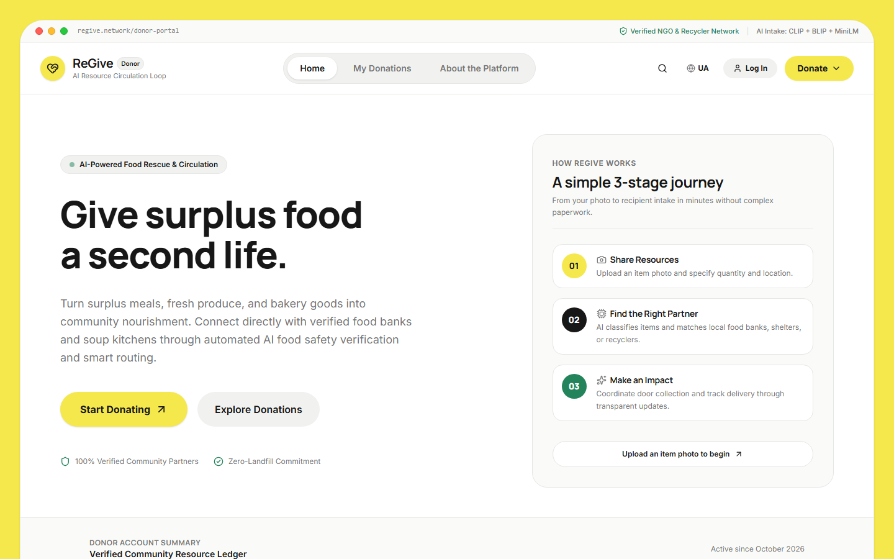
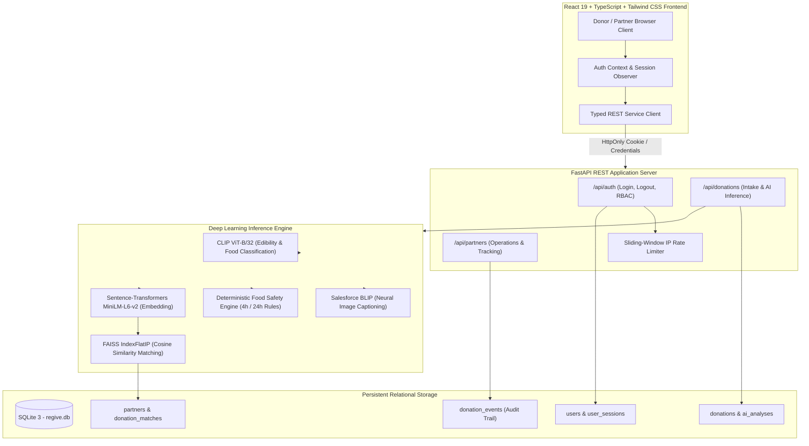
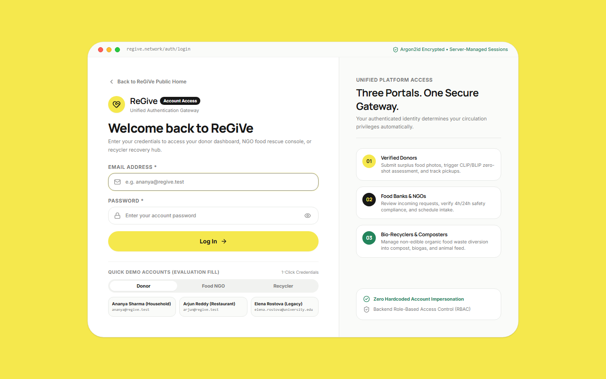
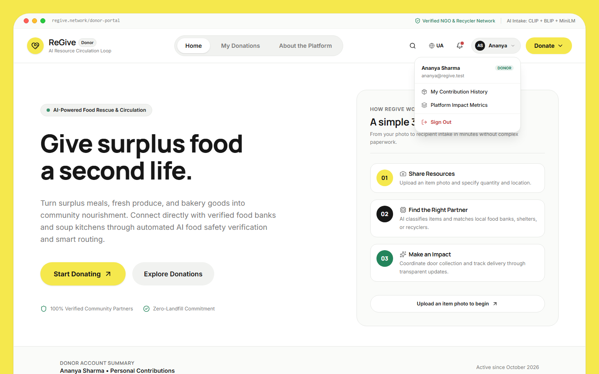
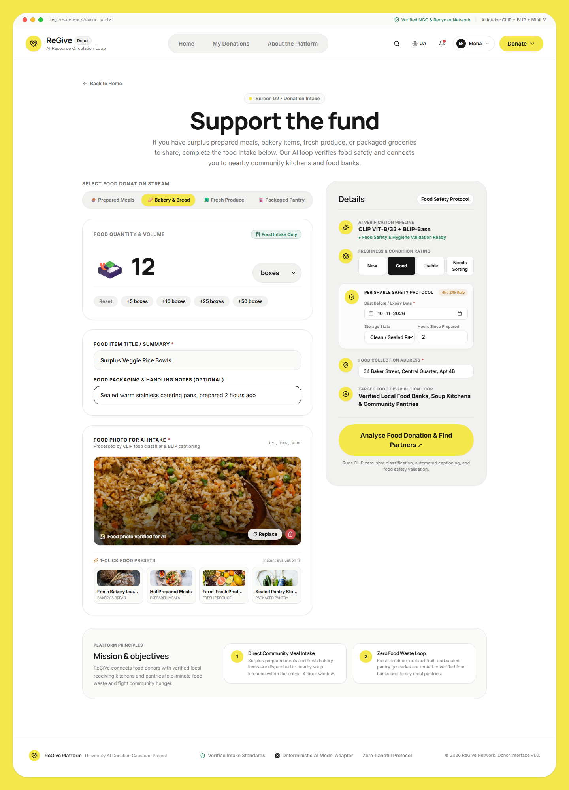
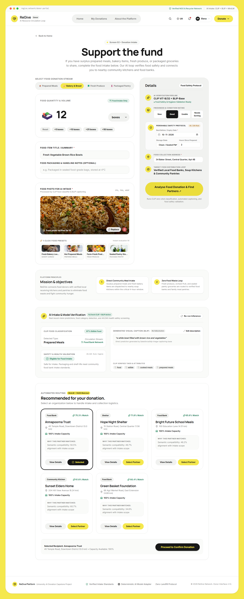
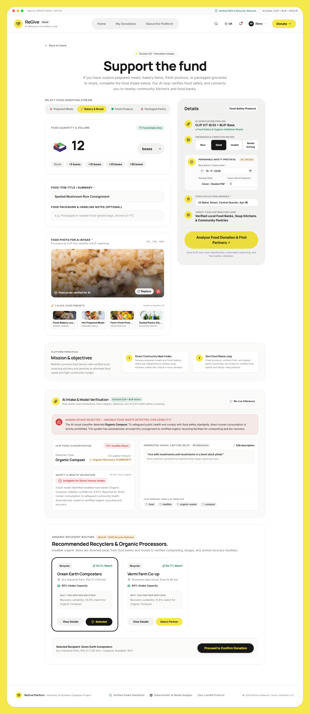
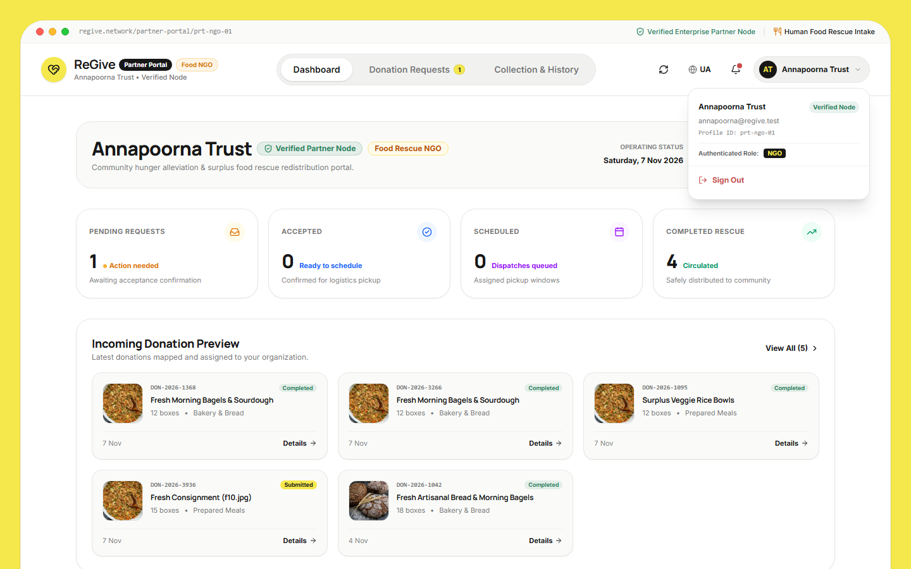
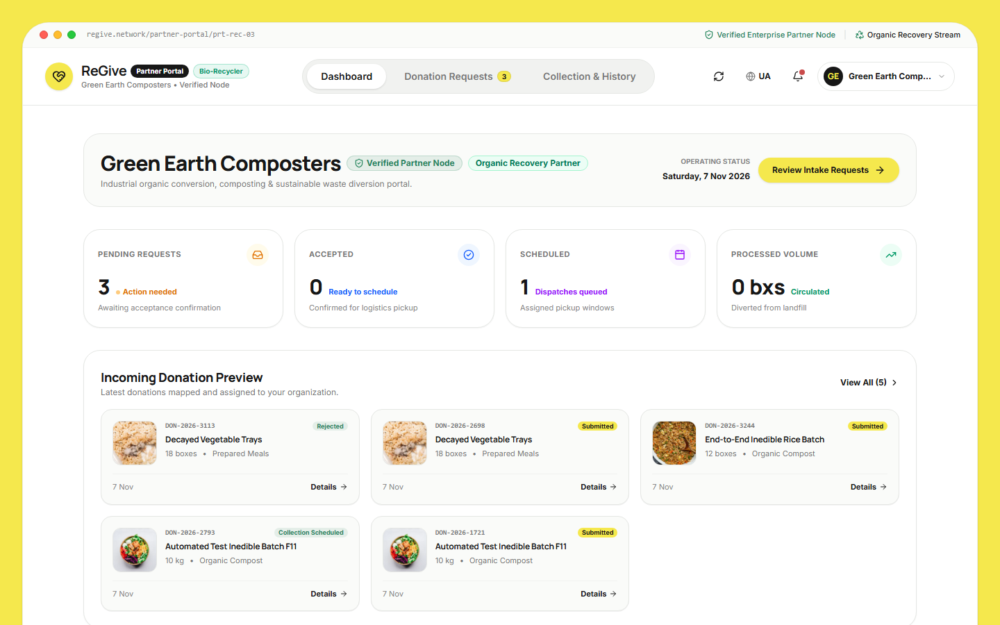
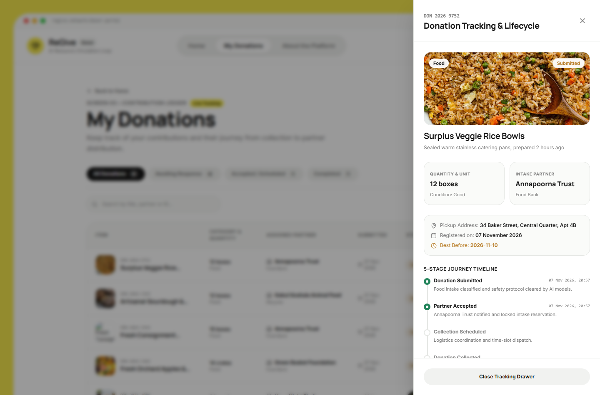

# ReGiVe — AI-Powered Food Rescue & Resource Circulation Loop

<div align="center">



<p align="center">
  <strong>An automated, zero-waste food rescue platform connecting community donors with verified food banks and bio-recyclers using multi-modal AI classification, deterministic safety rules, and semantic vector matching.</strong>
</p>

[](https://react.dev/)
[](https://www.typescriptlang.org/)
[](https://vitejs.dev/)
[](https://tailwindcss.com/)
[](https://fastapi.tiangolo.com/)
[](https://www.python.org/)
[](https://pytorch.org/)
[](https://github.com/openai/CLIP)
[](https://github.com/salesforce/BLIP)
[](https://github.com/facebookresearch/faiss)
[](https://en.wikipedia.org/wiki/Argon2)
[](https://www.sqlite.org/)

</div>

---

## 📖 Table of Contents

- [Overview](#-overview)
- [System Architecture](#-system-architecture)
- [Core AI & ML Pipeline](#-core-ai--ml-pipeline)
- [Key Features](#-key-features)
- [Screenshots & Walkthrough](#-screenshots--walkthrough)
- [Role-Based Access Control (RBAC)](#-role-based-access-control-rbac)
- [Project Structure](#-project-structure)
- [Getting Started](#-getting-started)
  - [Prerequisites](#prerequisites)
  - [Backend Setup](#1-backend-setup)
  - [Frontend Setup](#2-frontend-setup)
- [Synthetic Evaluation Accounts](#-synthetic-evaluation-accounts)
- [API Reference](#-api-reference)
- [Automated Verification & Tests](#-automated-verification--tests)
- [Security & Credential Safety](#-security--credential-safety)
- [License](#-license)

---

## 🌟 Overview

**ReGiVe** is an intelligent, dual-stream circular economy platform engineered to eliminate urban food waste and address food insecurity. By pairing computer vision with multi-attribute food safety evaluation and vector-indexed logistics routing, ReGiVe eliminates manual triage:

1. **Human Food Rescue Stream (Perishables & Edibles)**: Donated surplus cooked meals, bakery batches, and fresh produce are automatically assessed for edibility and routed to verified local food banks, community kitchens, and shelters within safe consumption windows.
2. **Organic Bio-Recovery Stream (Spoiled & Inedible Food)**: Spoiled, decayed, or unsealed food is diverted away from municipal landfills directly to bio-recycling partners for animal feed, aerobic composting, and biomethanation plants.

ReGiVe adheres to an editorial design system featuring a signature `#F5E84D` brand accent, minimal borders, crisp typography, and interactive lifecycle tracking drawers.

---

## 🏛 System Architecture



---

## 🧠 Core AI & ML Pipeline

ReGiVe integrates a 5-stage inference pipeline that executes synchronously on incoming donation photos:

```
[Uploaded Photo]
       │
       ├──► 1. Zero-Shot Edibility Analysis (OpenAI CLIP ViT-B/32)
       │       Computes normalized cosine similarity against paired edibility prompts.
       │       Produces continuous edibility score ∈ [0.0, 1.0].
       │
       ├──► 2. Waste Stream & Food Type Classification (CLIP Zero-Shot)
       │       Classifies items into specific food types or organic waste categories.
       │
       ├──► 3. Automated Neural Captioning (Salesforce BLIP-Base)
       │       Generates natural-language visual descriptions from pixel tensors.
       │
       ├──► 4. Deterministic Food Safety Verification (4-Hour / 24-Hour Rule)
       │       Evaluates cooking timestamp, shelf-life date, and packaging condition.
       │       Assigns regulatory verdict: 'Eligible', 'Caution', or 'Ineligible'.
       │
       └──► 5. Semantic Vector Index & Multi-Objective Matching (MiniLM + FAISS)
               Encodes intake description into a 384-dimensional dense semantic vector.
               Performs vector search over registered partners indexed in FAISS.
               Computes composite match score:
               Final Score = 0.40 × Similarity + 0.35 × Proximity + 0.25 × Capacity
```

---

## ⚡ Key Features

- **Multi-Modal Visual Intake**: Upload or drag-and-drop food items with instant zero-shot recognition.
- **Unified Authentication Gateway**: Shared login screen servicing Donors, Food NGOs, Bio-Recyclers, and Admins without manual role selection dropdowns.
- **Cryptographic Security**: Passwords salted and hashed with **Argon2id**; sessions tracked via server-side database records and `HttpOnly`, `SameSite=Lax` cookies.
- **Brute-Force Rate Limiting**: In-memory sliding-window throttle restricts repeated unauthorized login attempts (HTTP 429).
- **Isolated Partner Dashboards**: Dedicated consoles for Food NGOs and Bio-Recyclers with complete isolation—partners cannot query or alter rival nodes.
- **5-Stage Dispatch Audit Trail**: Real-time event tracking (`Submitted` → `Accepted` → `Scheduled` → `Collected` → `Completed`).
- **Zero Hardcoded Accounts**: All 21 evaluation accounts, profiles, donations, and matches are persisted and queryable in SQLite.

---

## 📸 Screenshots & Walkthrough

### 1. Donor Public Landing Page
The clean, editorial landing page welcoming community contributors. Displays the verified network badge, mission principles, and the secure top navigation bar.


---

### 2. Unified 3-Portal Authentication Gateway
A shared login screen serving all 4 user roles. Features cryptographic Argon2id validation, server-managed sessions, and 1-click test credentials for evaluators.



---

### 3. Dynamic Authenticated Donor Interface
Upon donor authentication, the navigation adapts with dynamic initials avatar, role badge, personal contribution counters, and authenticated sign-out.



---

### 4. Multi-Attribute Donation Intake
Enables donors to specify quantity, units, packaging condition, cooked timestamp, and upload visual documentation for automated classification.



---

### 5. Multi-Modal AI Food Safety Verification & NGO Matching
Real PyTorch output: CLIP ViT-B/32 classifies food edibility, BLIP generates natural captioning, safety rules enforce the 4h/24h rule, and FAISS matches verified food banks.



---

### 6. Automated Inedible Food Detection & Bio-Recycler Routing
When decayed or spoiled produce is uploaded, the AI flags the item as ineligible for human intake and automatically routes it to organic bio-composters and animal feed partners.



---

### 7. Food Rescue Partner Console (Food NGO)
Verified food banks review real-time incoming intake requests, inspect AI classification tags, and accept donations based on meal portion capacity.



---

### 8. Bio-Recycler Organic Recovery Portal
Dedicated organic recovery console for composters and biomethanation plants to manage waste diversion, track incoming volume, and schedule collections.



---

### 9. Real-Time Donation Lifecycle & Dispatch Tracking
An interactive slide-out drawer providing donors and receiving partners with a transparent 5-stage dispatch audit trail from intake to community distribution.



---

## 🔒 Role-Based Access Control (RBAC)

ReGiVe enforces strict authorization boundaries across all API endpoints:

| Feature / Operation | Unauthenticated | Donor | Food NGO | Bio-Recycler | Super Admin |
| :--- | :---: | :---: | :---: | :---: | :---: |
| **Browse Landing Page & Mission** | ✅ | ✅ | ✅ | ✅ | ✅ |
| **Run Real AI Model Analysis** | ✅ | ✅ | ✅ | ✅ | ✅ |
| **Submit Food Donation** | 🔒 Guarded | ✅ (Own Identity) | ❌ 403 Forbidden | ❌ 403 Forbidden | ✅ |
| **View Personal Donation Ledger** | ⚠️ Public Demo | ✅ (Scoped) | ❌ 403 Forbidden | ❌ 403 Forbidden | ✅ (All) |
| **Access NGO Dashboard** | ❌ 401 | ❌ 403 Forbidden | ✅ (Own Node Only) | ❌ 403 Forbidden | ✅ |
| **Access Recycler Dashboard** | ❌ 401 | ❌ 403 Forbidden | ❌ 403 Forbidden | ✅ (Own Node Only) | ✅ |
| **Accept / Schedule / Complete** | ❌ 401 | ❌ 403 Forbidden | ✅ (Assigned Only) | ✅ (Assigned Only) | ✅ |

> [!NOTE]
> For a full capability breakdown, consult the [Role Permission Matrix](docs/ROLE_PERMISSION_MATRIX.md).

---

## 📁 Project Structure

```text
Excel_Project/
├── backend/                        # FastAPI Python Application
│   ├── data/                       # Partner catalogs, sample datasets, FAISS index
│   ├── migrations/                 # Idempotent SQLite database migration scripts
│   ├── routes/                     # Modular API routers
│   │   ├── auth.py                 # Argon2id login, session cookies, RBAC dependencies
│   │   ├── donations.py            # AI inference pipeline & donation persistence
│   │   └── partners.py             # Partner dashboards, triage & lifecycle updates
│   ├── scripts/                    # Database initialization & account seeding
│   ├── services/                   # Deep learning models & core logic
│   │   ├── ai_pipeline.py          # CLIP, BLIP, FAISS, and Food Safety Rules
│   │   └── auth_service.py         # Password hashing & rate limiting
│   ├── database.py                 # SQLAlchemy session engine & connection pool
│   ├── main.py                     # FastAPI application entry point & CORS
│   ├── models.py                   # ORM Entity models (Users, Donations, Partners)
│   ├── schemas.py                  # Pydantic v2 validation contracts
│   └── regive.db                   # Persistent SQLite database instance
├── docs/                           # Technical Specifications & Audit Reports
│   ├── screenshots/                # Application verification captures
│   ├── AUTHENTICATION_ARCHITECTURE_AUDIT.md
│   ├── AUTHENTICATION_IMPLEMENTATION_REPORT.md
│   ├── DATABASE_MIGRATION_REPORT.md
│   ├── DEMO_ACCOUNT_SETUP.md
│   └── ROLE_PERMISSION_MATRIX.md
├── src/                            # React 19 Frontend Application
│   ├── assets/                     # Static brand assets and SVGs
│   ├── components/                 # Reusable UI component modules
│   │   ├── home/                   # Hero section, overview counters, explainers
│   │   ├── layout/                 # Donor navigation header, footer, shell
│   │   └── partner/                # Partner header, drawers, request cards
│   ├── context/                    # React Context (AuthContext & Session management)
│   ├── pages/                      # Page components
│   │   ├── auth/                   # Unified LoginPage with 1-click evaluator fill
│   │   ├── partner/                # PartnerDashboard, Requests, CollectionHistory
│   │   ├── CreateDonation.tsx      # Multi-attribute donation intake & AI trigger
│   │   ├── DonorHome.tsx           # Public and authenticated donor overview
│   │   └── MyDonations.tsx         # Donation ledger with live status filters
│   ├── services/                   # Frontend API integration clients
│   ├── types/                      # TypeScript domain interface definitions
│   ├── App.tsx                     # Top-level state coordinator & route guards
│   ├── index.css                   # Tailwind CSS v4 design tokens
│   └── main.tsx                    # React application bootstrap
├── tests/                          # Automated Verification Suites
│   ├── capture_auth_screenshots.py # Playwright visual verification script
│   └── test_authentication_rbac_e2e.py # 12-stage E2E integration test suite
├── .gitignore                      # Git exclusion rules (credentials & caches)
├── package.json                    # Node.js dependencies & scripts
├── tsconfig.json                   # TypeScript compiler configuration
└── vite.config.ts                  # Vite build tool configuration
```

---

## 🚀 Getting Started

### Prerequisites

- **Node.js**: `v18.0.0` or higher
- **Python**: `v3.10` to `v3.14`
- **Git**

---

### 1. Backend Setup

1. Open a terminal and navigate to the project root:
   ```bash
   cd Excel_Project
   ```

2. (Optional but recommended) Create and activate a Python virtual environment:
   ```bash
   # Windows PowerShell
   python -m venv venv
   .\venv\Scripts\Activate.ps1

   # Linux / macOS
   python3 -m venv venv
   source venv/bin/activate
   ```

3. Install required Python packages:
   ```bash
   pip install fastapi uvicorn sqlalchemy pillow torch torchvision transformers sentence-transformers faiss-cpu "pwdlib[argon2]"
   ```

4. Initialize the SQLite database and seed evaluation accounts:
   ```bash
   python backend/scripts/seed_demo_accounts.py
   ```

5. Launch the FastAPI server:
   ```bash
   python -m uvicorn backend.main:app --host 127.0.0.1 --port 8000 --reload
   ```
   *The backend will be available at: `http://127.0.0.1:8000` (API documentation at `/docs`).*

---

### 2. Frontend Setup

1. In a separate terminal window, navigate to the project directory:
   ```bash
   cd Excel_Project
   ```

2. Install Node.js dependencies:
   ```bash
   npm install
   ```

3. Start the Vite development server:
   ```bash
   npm run dev
   ```
   *The application will launch at: `http://localhost:5173`.*

---

## 👥 Synthetic Evaluation Accounts

For academic and evaluation testing, ReGiVe comes pre-seeded with **21 synthetic demo accounts** using the RFC 2606 reserved `.test` domain.

Evaluators can populate these credentials into the login form with a single click using the **Quick Demo Accounts** tab on the login screen, or sign in manually:

| Persona | Organization / Name | Synthetic Email | Role | Profile Focus |
| :--- | :--- | :--- | :--- | :--- |
| **Donor** | Ananya Sharma | `ananya@regive.test` | `donor` | Household Fresh Food Rescue |
| **Donor** | Arjun Reddy | `arjun@regive.test` | `donor` | Commercial Restaurant Surplus |
| **Donor** | Elena Rostova | `elena.rostova@university.edu` | `donor` | Academic Campus Dining Surplus |
| **Food NGO** | Annapoorna Trust | `annapoorna@regive.test` | `ngo` | Central Urban Food Bank |
| **Food NGO** | Hope Night Shelter | `hope@regive.test` | `ngo` | Emergency Night Shelter |
| **Food NGO** | Bright Future Kitchen | `brightfuture@regive.test` | `ngo` | Community Kitchen |
| **Bio-Recycler** | Green Earth Composters | `greenearth@regive.test` | `recycler` | Aerobic Industrial Composting |
| **Bio-Recycler** | Gokul Goshala Feed | `gokul@regive.test` | `recycler` | Organic Cattle Feed Recovery |
| **Bio-Recycler** | BioGas Energy Plant | `biogas@regive.test` | `recycler` | Methane Bio-Energy Digester |
| **Admin** | System Administrator | `admin@regive.test` | `admin` | Platform Governance & Node Audit |

> [!TIP]
> Complete credentials and setup instructions are documented in the [Demo Account Setup Guide](docs/DEMO_ACCOUNT_SETUP.md).

---

## 📡 API Reference

### Authentication Endpoints (`/api/auth`)

- `POST /api/auth/login`: Authenticates credentials with Argon2id and sets `regive_session` HttpOnly cookie.
- `POST /api/auth/logout`: Invalidates server session record and clears client session cookie.
- `GET /api/auth/me`: Returns the authenticated user's profile and linked entity role.
- `GET /api/auth/status`: Lightweight session probe returning `{ authenticated: boolean, user: ... }`.

### Donations & AI Inference (`/api/donations`)

- `POST /api/donations/analyze`: Executes multi-modal AI models (CLIP + BLIP + Safety Rules + FAISS) on uploaded food photos.
- `POST /api/donations`: Persists a verified donation record with its full AI analysis and tracking timeline.
- `GET /api/donations`: Retrieves donation history (scoped to current authenticated donor).
- `GET /api/donations/{id}`: Returns single donation record with full 5-stage tracking timeline.

### Partner Operations (`/api/partners`)

- `GET /api/partners/{partner_id}/dashboard`: Real-time operational dashboard with metrics and incoming requests.
- `GET /api/partners/{partner_id}/donations`: Filtered donation requests assigned to this partner.
- `POST /api/partners/{partner_id}/donations/{id}/accept`: Confirms intake capacity (Stage 2).
- `POST /api/partners/{partner_id}/donations/{id}/reject`: Declines request with structured reason.
- `POST /api/partners/{partner_id}/donations/{id}/schedule`: Assigns vehicle pickup date & window (Stage 3).
- `POST /api/partners/{partner_id}/donations/{id}/collect`: Confirms courier pickup (Stage 4).
- `POST /api/partners/{partner_id}/donations/{id}/complete`: Marks community distribution complete (Stage 5).

---

## 🧪 Automated Verification & Tests

ReGiVe includes an automated end-to-end integration test suite verifying backend API endpoints, role boundaries, rate limits, and AI inference pipelines:

```bash
# Run the complete test suite
python tests/test_authentication_rbac_e2e.py
```

### Test Coverage Summary:
- **TEST 01**: Unauthenticated session probe baseline.
- **TEST 02**: Donor authentication & Argon2id hash verification.
- **TEST 03**: Session restoration via cookie & donor donation scoping.
- **TEST 04**: Donor access to partner operations denied with `403 Forbidden`.
- **TEST 05**: Logout session invalidation on server and client.
- **TEST 06**: Food NGO authentication and profile linkage.
- **TEST 07**: NGO dashboard access and live request queue verification.
- **TEST 08**: Cross-partner isolation enforced with `403 Forbidden`.
- **TEST 09**: Partner donation creation denied with `403 Forbidden`.
- **TEST 10**: Bio-Recycler authentication and organic loop dashboard verification.
- **TEST 11**: Brute-force rate limiting triggered with `429 Too Many Requests`.
- **TEST 12**: Real PyTorch AI model pipeline verification (CLIP, BLIP, FAISS).

To capture visual verification screenshots using Playwright:
```bash
python tests/capture_auth_screenshots.py
```

---

## 🛡 Security & Credential Safety

ReGiVe adheres to strict application security standards:
- **No Hardcoded Secrets**: Secret keys, production passwords, and private certificates are excluded from version control via `.gitignore`.
- **Database Identity Integrity**: All user identities are bound to foreign keys on verified `donors` or `partners` records in SQLite.
- **Cookie Hardening**: All authentication cookies employ `HttpOnly` (preventing XSS access) and `SameSite=Lax` (preventing CSRF).
- **Rate-Limiting Protection**: Sliding-window throttling stops credential stuffing and brute-force attacks at the gateway.

---

## 📄 License

This project is licensed under the [MIT License](LICENSE).

---

<div align="center">
  <strong>ReGiVe AI Platform</strong> • Built with ❤️ for community food rescue and landfill elimination.
</div>
