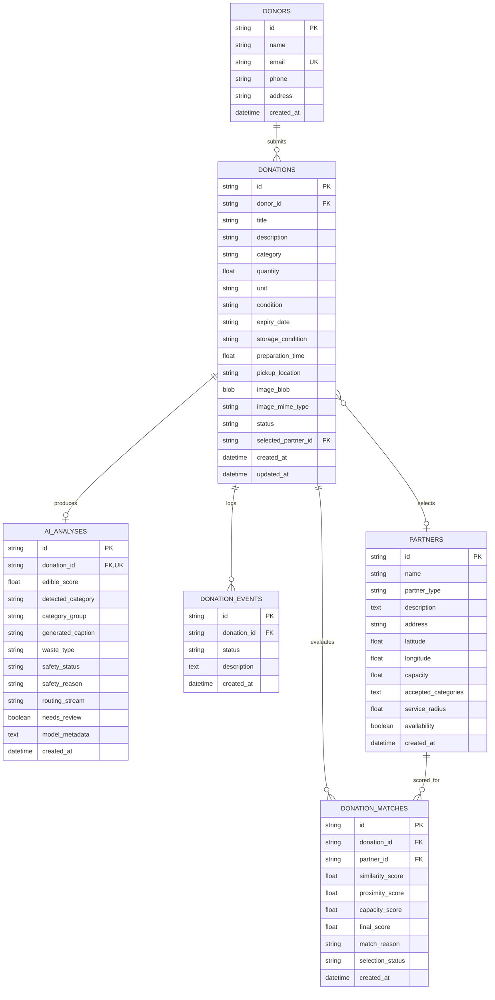

# ReGiVe Relational Database Schema Specification
**Document ID:** `docs/DATABASE_SCHEMA.md`  
**Database File:** `regive.db` (SQLite 3 via SQLAlchemy 2.0)  
**Date:** November 2026  
**Auditor & Database Architect:** Senior Database & Backend Architect  

---

## 1. Schema Architecture & Design Objectives

The ReGiVe database provides persistent, ACID-compliant storage across backend restarts. It uses **SQLite** with **SQLAlchemy 2.0 ORM** and enforces:
- Foreign key constraints enabled via SQLite pragma (`PRAGMA foreign_keys = ON;`).
- Direct binary storage (`BLOB`) for uploaded donation images to ensure self-contained portability without dangling local disk path dependencies.
- Structured temporal tracking via `donation_events` for end-to-end provenance.
- Separation of raw input data, AI inference telemetry, and partner matching rankings.

---

## 2. Entity-Relationship Model (ERD)

---

## 3. Relational Tables Detailed Specification

### 3.1 `donors`
Represents registered platform contributors.
| Column | Type | Constraints | Description |
|---|---|---|---|
| `id` | VARCHAR(36) | PRIMARY KEY | Unique UUID or prefix (e.g. `usr-elena-01`) |
| `name` | VARCHAR(128) | NOT NULL | Full donor or organization name |
| `email` | VARCHAR(128) | UNIQUE, NOT NULL | Primary contact email |
| `phone` | VARCHAR(32) | NULLABLE | Contact telephone |
| `address` | TEXT | NOT NULL | Default registered collection address |
| `created_at` | DATETIME | NOT NULL, DEFAULT NOW | Account registration timestamp |

### 3.2 `donations`
The central resource ledger entity.
| Column | Type | Constraints | Description |
|---|---|---|---|
| `id` | VARCHAR(36) | PRIMARY KEY | Identifier (e.g. `DON-2026-1042`) |
| `donor_id` | VARCHAR(36) | FOREIGN KEY $\rightarrow$ `donors.id` | Associated donor |
| `title` | VARCHAR(256) | NOT NULL | Resource headline or item title |
| `description` | TEXT | NULLABLE | Detailed description or user notes |
| `category` | VARCHAR(64) | NOT NULL | Food, Clothing, Books, etc. |
| `quantity` | FLOAT | NOT NULL, CHECK > 0 | Numeric quantity count or weight |
| `unit` | VARCHAR(32) | NOT NULL | boxes, pieces, kg, packs, etc. |
| `condition` | VARCHAR(32) | NOT NULL | New, Good, Usable, Needs Sorting |
| `expiry_date` | VARCHAR(32) | NULLABLE | ISO date (YYYY-MM-DD) for perishables |
| `storage_condition`| VARCHAR(32) | NULLABLE | `room`, `fridge`, or `sealed` |
| `preparation_time` | FLOAT | NULLABLE | Hours elapsed since cooked |
| `pickup_location` | TEXT | NOT NULL | Physical collection location |
| `image_blob` | BLOB | NOT NULL | Raw binary bytes of uploaded image |
| `image_mime_type` | VARCHAR(64) | NOT NULL | `image/jpeg`, `image/png`, `image/webp` |
| `status` | VARCHAR(32) | NOT NULL | Lifecycle status enum |
| `selected_partner_id`| VARCHAR(36)| FOREIGN KEY $\rightarrow$ `partners.id` | Assigned recipient organization |
| `created_at` | DATETIME | NOT NULL, DEFAULT NOW | Intake timestamp |
| `updated_at` | DATETIME | NOT NULL, DEFAULT NOW | Last state transition |

*Supported Status Enum Values:*
`DRAFT`, `ANALYSIS_COMPLETED`, `SUBMITTED`, `PROCESSING`, `AWAITING_PARTNER`, `ACCEPTED`, `COLLECTION_SCHEDULED`, `COLLECTED`, `COMPLETED`, `REJECTED`, `EXPIRED`.

### 3.3 `ai_analyses`
Model inference telemetry and safety validation outputs.
| Column | Type | Constraints | Description |
|---|---|---|---|
| `id` | VARCHAR(36) | PRIMARY KEY | Unique analysis UUID |
| `donation_id` | VARCHAR(36) | FOREIGN KEY $\rightarrow$ `donations.id`, UNIQUE | 1:1 relation with donation |
| `edible_score` | FLOAT | NOT NULL | CLIP confidence for edible food (0.00–1.00) |
| `detected_category`| VARCHAR(64)| NOT NULL | Sub-label (e.g., `rice dish or biryani`) |
| `category_group` | VARCHAR(64) | NOT NULL | Broad label (e.g., `cooked meals`) |
| `generated_caption`| TEXT | NOT NULL | Neural BLIP caption |
| `waste_type` | VARCHAR(64) | NULLABLE | Non-edible label if inedible |
| `safety_status` | VARCHAR(32) | NOT NULL | `Eligible`, `Needs Review`, `Not Eligible` |
| `safety_reason` | TEXT | NOT NULL | Plain-English safety justification |
| `routing_stream` | VARCHAR(32) | NOT NULL | `human`, `animal`, `compost`, `biogas` |
| `needs_review` | BOOLEAN | NOT NULL | Borderline classification indicator |
| `model_metadata` | TEXT | NULLABLE | JSON string with pipeline diagnostics |
| `created_at` | DATETIME | NOT NULL, DEFAULT NOW | Timestamp of inference run |

### 3.4 `partners`
Verified recipient organizations (NGOs, Food Banks, Shelters, and Recyclers).
| Column | Type | Constraints | Description |
|---|---|---|---|
| `id` | VARCHAR(36) | PRIMARY KEY | Partner identifier (e.g., `prt-ngo-01`) |
| `name` | VARCHAR(128) | NOT NULL | Legal name of organization |
| `partner_type` | VARCHAR(64) | NOT NULL | `Food Bank`, `Shelter`, `Recycler`, `NGO` |
| `description` | TEXT | NOT NULL | Scope text used for MiniLM FAISS indexing |
| `address` | TEXT | NOT NULL | Physical facility address |
| `latitude` | FLOAT | NOT NULL | Geographic latitude |
| `longitude` | FLOAT | NOT NULL | Geographic longitude |
| `capacity` | FLOAT | NOT NULL | Max daily intake capacity (meals or kg) |
| `accepted_categories`| TEXT | NOT NULL | JSON array of accepted categories |
| `service_radius` | FLOAT | NOT NULL | Service operational radius in km |
| `availability` | BOOLEAN | NOT NULL, DEFAULT TRUE | Intake status active/paused |
| `created_at` | DATETIME | NOT NULL, DEFAULT NOW | Registration timestamp |

### 3.5 `donation_matches`
Ranked partner recommendations scored via FAISS, proximity, and capacity.
| Column | Type | Constraints | Description |
|---|---|---|---|
| `id` | VARCHAR(36) | PRIMARY KEY | Unique match UUID |
| `donation_id` | VARCHAR(36) | FOREIGN KEY $\rightarrow$ `donations.id` | Target donation |
| `partner_id` | VARCHAR(36) | FOREIGN KEY $\rightarrow$ `partners.id` | Candidate partner |
| `similarity_score` | FLOAT | NOT NULL | MiniLM cosine similarity |
| `proximity_score` | FLOAT | NOT NULL | Normalized distance score |
| `capacity_score` | FLOAT | NOT NULL | Normalized intake capacity ratio |
| `final_score` | FLOAT | NOT NULL | Multi-factor weighted match score (0–100) |
| `match_reason` | TEXT | NOT NULL | Explanation string |
| `selection_status` | VARCHAR(32) | NOT NULL, DEFAULT 'RECOMMENDED'| `RECOMMENDED`, `SELECTED`, `CONFIRMED` |
| `created_at` | DATETIME | NOT NULL, DEFAULT NOW | Score calculation timestamp |

### 3.6 `donation_events`
Immutable tracking history.
| Column | Type | Constraints | Description |
|---|---|---|---|
| `id` | VARCHAR(36) | PRIMARY KEY | Event UUID |
| `donation_id` | VARCHAR(36) | FOREIGN KEY $\rightarrow$ `donations.id` | Target donation |
| `status` | VARCHAR(32) | NOT NULL | Status transition marker |
| `description` | TEXT | NOT NULL | Audit message describing the stage |
| `created_at` | DATETIME | NOT NULL, DEFAULT NOW | Event timestamp |

---

## 4. Indexing Strategy & Transaction Boundaries

1. **Indexes:**
   - `idx_donations_donor`: On `donations(donor_id)`.
   - `idx_donations_status`: On `donations(status)`.
   - `idx_matches_donation`: On `donation_matches(donation_id)`.
   - `idx_events_donation`: On `donation_events(donation_id, created_at)`.
2. **Transaction Boundaries:**
   - Image upload and AI inference are executed within an atomic database transaction. If model inference crashes or image validation fails, transaction rolls back cleanly.
   - Confirmation is executed atomically: updates donation status to `SUBMITTED`, locks the selected partner in `donation_matches`, and inserts a corresponding record in `donation_events`.
3. **Database Seeding Strategy:**
   - On initial startup, if the database file does not exist, tables are created via `Base.metadata.create_all(engine)`.
   - A seeding routine automatically imports the verified donor (`usr-elena-01`), all 6 NGOs, and all 6 Recyclers from `exsel_project.ipynb`.
